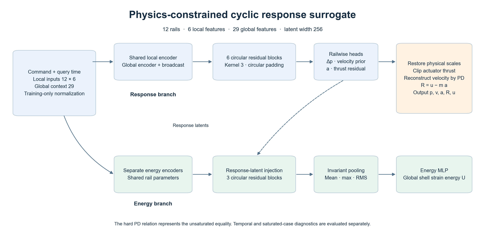
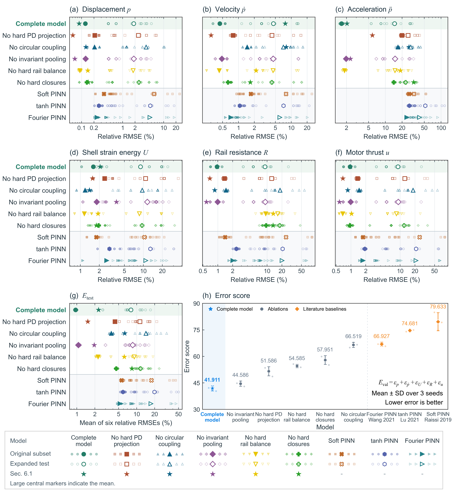

# Cyclic Physics-Constrained Surrogate

**Rapid prediction of coupled rail responses and shell strain energy during flexible nozzle deployment.**

[English](README.md) · [简体中文](README.zh-CN.md) · [Data guide](docs/data_schema.md) · [Reproduction guide](docs/reproduction.md)


This repository accompanies the neural response-prediction component of the flexible variable-area nozzle study. It provides recorded simulation responses, frozen data partitions, preprocessing, trained parameters, training code, ablations, three literature-inspired PINN baselines and standalone evaluation. The structural ALE model, time integrator, Abaqus models and deployment-control solvers remain outside this release.



## What is included

| Component | Released content |
|---|---|
| Simulation responses | 200 indexed source histories with rail position, velocity, reference, motor thrust and shell strain energy |
| Prepared learning data | Two archived tables, each with 19,528 twelve-rail records, plus exact row and simulation identifiers |
| Grouped assessment | 84 training, 32 validation and 25 formal test simulations, sealed by cyclic equivalence group |
| Trained models | 33 exact archived checkpoints, comprising 6 nominal runs and 27 runs across 9 configurations and 3 matched seeds |
| Extra conditions | 31 recorded supplementary cases for frozen-weight evaluation |
| Reproduction tools | Training, raw-response preprocessing, archived-prediction checks, grouped error aggregation and physical diagnostics |

The `data/processed` tables represent the archived operator-training selection. Their row counts describe the supplied learning tables. The full indexed source histories also retain candidate simulations excluded from that selection. The source-history archive contains responses from simulations already completed by the authors.

## Quick start

```bash
git clone https://github.com/PaimonAllen/Cyclic-Physics-Constrained-Surrogate.git
cd Cyclic-Physics-Constrained-Surrogate
python -m pip install -r requirements.txt

# Rebuild model features and labels from the supplied rail histories
python scripts/prepare_data.py --protocol grouped

# Run all three released complete-model checkpoints and check archived predictions
python scripts/evaluate.py --protocol grouped --model full --check-archived
```

Python 3.11 or newer is recommended. CPU inference is supported. A CUDA-compatible PyTorch installation can accelerate training and evaluation through `--device cuda`. All commands run independently of the parent development repository.

## Predict from commands only

The supplied example contains command and context arrays, with no response targets. It illustrates standalone inference.

```bash
python scripts/predict.py --device cpu
python scripts/verify_release.py
```

Use a complete reference-command sequence that includes its terminal reference stage. The feature builder derives terminal deployment amplitude from that stage. Output fields are `p`, `pdot`, `accel`, `energy`, `resistance` and `force` in SI units.

## Reproduce training and comparisons

```bash
# Complete model with the matched-seed grouped protocol
python scripts/train.py --protocol grouped --model full --run run_01 --epochs 3000 --device cuda

# Five component ablations and the three PINN baselines use the same entry point
python scripts/train.py --protocol grouped --model no_pd_projection --run run_01 --device cuda
python scripts/train.py --protocol grouped --model soft_pinn --run run_01 --device cuda
python scripts/train.py --protocol grouped --model soft_pinn_tanh --run run_01 --device cuda
python scripts/train.py --protocol grouped --model soft_pinn_fourier --run run_01 --device cuda

# Evaluate every supplied checkpoint, then inspect physical consistency
python scripts/evaluate.py --protocol all --model all --check-archived
python scripts/diagnostics.py --model full --run run_01
python scripts/evaluate_supplementary.py --model full --run run_01
```

The three matched initialization runs use the public labels **run_01**, **run_02** and **run_03**. Run-specific hyperparameters and normalization arrays accompany each checkpoint. The training wrapper restores the selected configuration, prints percentage RMSEs, and saves loss and RMSE plots every 100 epochs by default. Fresh training writes to `outputs/`. Use **--seed** to choose the initialization for a new training run; by default an initialization seed is drawn for that execution. For a matched comparison, use the same user-selected **--seed** for every model within a run. For a matched comparison, use the same user-selected **--seed** for every model within a run. The original nominal full-model run continued a 2,000-epoch run to 3,000 epochs. Its exact trained checkpoint and stored optimizer/scheduler state are provided; a fresh 3,000-epoch training run can differ numerically from that continuation. Hardware and PyTorch differences can also change fresh training outcomes.

Use `--batch-size` to adapt training to available memory; retain the archived batch size of 512 for the formal comparison.

## Architecture

Each rail receives six command/reference features. A shared encoder combines them with 29 global context features. Six circular residual blocks exchange neighboring rail information using kernel-3 convolutions with periodic padding. Rail heads predict displacement residual, a velocity prior, acceleration and thrust residual. Physical scaling, thrust clipping, the PD equality and rail force balance reconstruct the delivered rail responses.

An independent energy branch receives the same command context and projected response latents. Three circular residual blocks are followed by mean, maximum and RMS pooling. These pooled features and the global latent feed a scalar shell-energy head. The standard latent width is 256. Checkpoint-specific dimensions for the parameter-matched dense baselines are recorded in `config.json`.

The hard PD inversion represents the unsaturated control equality. Saturated commands and temporal derivative consistency are separate diagnostics. The network predicts queried responses directly; its acceleration and velocity outputs are learned response quantities with the documented algebraic closures.

## Reported comparison

Lower errors and lower error scores indicate greater accuracy. Values below are the archived mean ± sample standard deviation across three matched seeds. Each seed is aggregated with equal cyclic-group weights.

| Model | Original 3 cases E_test (%) | Expanded 25 cases E_test (%) | Validation error score E_val |
|---|---:|---:|---:|
| Complete model | 0.955 ± 0.098 | 8.023 ± 0.233 | 41.911 ± 1.432 |
| No hard PD projection | 4.337 ± 0.699 | 11.313 ± 0.252 | 51.586 ± 2.589 |
| No circular coupling | 3.774 ± 1.881 | 14.261 ± 1.629 | 66.519 ± 1.457 |
| No invariant pooling | 1.066 ± 0.047 | 8.570 ± 0.224 | 44.586 ± 1.479 |
| No hard rail balance | 2.271 ± 0.151 | 9.112 ± 0.215 | 54.585 ± 0.969 |
| No hard closures | 4.571 ± 2.116 | 11.591 ± 0.870 | 57.951 ± 2.484 |
| Soft PINN | 5.617 ± 0.232 | 17.673 ± 0.297 | 79.633 ± 5.113 |
| tanh PINN | 5.903 ± 0.188 | 19.769 ± 0.519 | 74.681 ± 0.570 |
| Fourier PINN | 5.261 ± 0.151 | 17.299 ± 0.209 | 66.927 ± 1.128 |



For each response, relative RMSE is `100 × ||prediction − reference||₂ / ||reference||₂`. Errors are first pooled within each cyclic group, and groups then receive equal weights. The original subset spans two groups; the formal expanded test spans twelve groups and contains 6,126 time records or 73,512 rail points. Three legacy low-gain OOD simulations are separately labeled in the supplied split and excluded from the formal 25-case score.

`E_test` is the arithmetic mean of six relative RMSEs for displacement, velocity, acceleration, energy, resistance and thrust. `E_val` is the sum of the five validation errors for displacement, velocity, energy, resistance and thrust. It selects grouped-training checkpoints. The nominal single-run protocol retains its original split and selection rule. Its metrics are pooled across the original three cases and are reported separately from the grouped comparison.

## Repository layout

```text
├── scripts/            Training, preprocessing, inference and diagnostics
├── configs/            Released run registry
├── data/
│   ├── trajectories/   Recorded rail histories and case metadata
│   ├── processed/      Nominal and grouped learning tables
│   ├── splits/         Frozen simulation/group/row assignments
│   └── supplementary/ Additional command histories
├── models/             Exact archived checkpoints and learning curves
├── results/reported/   Numeric tables behind the paper comparison
├── docs/figures/       Architecture and response-comparison figures
└── SHA256SUMS          Integrity checks for release files
```

See [the data schema](docs/data_schema.md) for units, features and split semantics, and [the reproduction guide](docs/reproduction.md) for exact model identifiers and checks. A regular full clone contains both data and model files. A sparse checkout can be expanded using `git sparse-checkout disable` when sufficient disk space is available.

## Baseline references

The three PINNs are conditional-response baselines adapted to this nozzle dataset. The soft penalties follow PINN principles, the tanh network uses a DeepXDE-inspired dense design, and the Fourier network augments normalized time with fixed multiscale features. The exact nozzle-specific weights, widths and feature scales are released with each run. They are experimental choices of this study.

1. Raissi, Perdikaris and Karniadakis (2019). [Physics-informed neural networks](https://doi.org/10.1016/j.jcp.2018.10.045).
2. Lu, Meng, Mao and Karniadakis (2021). [DeepXDE](https://doi.org/10.1137/19M1274067).
3. Wang, Wang and Perdikaris (2021). [On the eigenvector bias of Fourier feature networks](https://doi.org/10.1016/j.cma.2021.113938).
