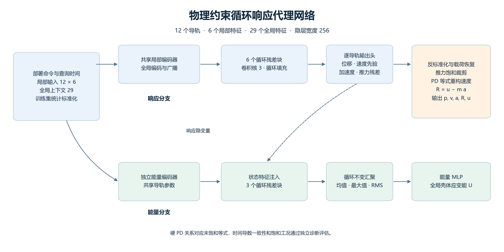
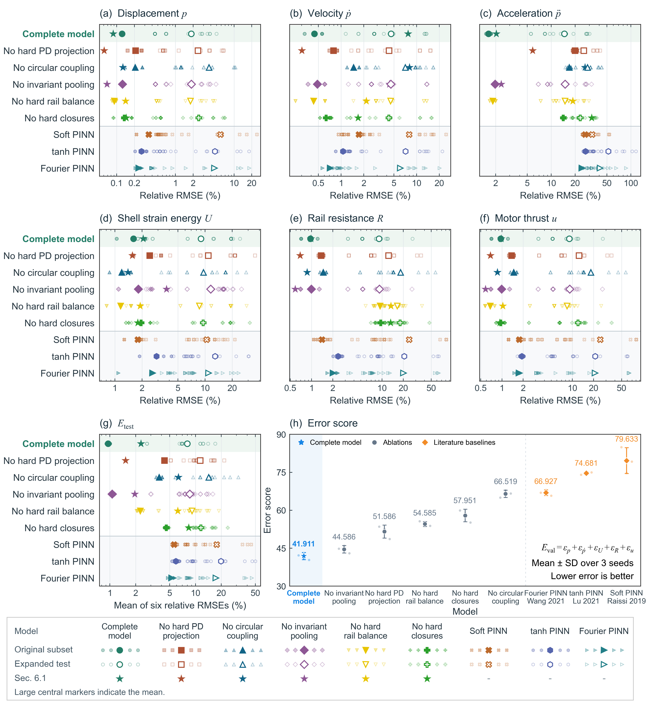

# 物理约束循环响应代理网络

**面向柔性变面积喷管部署，快速预测耦合导轨响应与壳体应变能。**

[English](README.md) · [简体中文](README.zh-CN.md) · [数据说明](docs/data_schema.zh-CN.md) · [复现指南](docs/reproduction.zh-CN.md)

本仓库发布论文中神经网络响应预测部分所需的仿真响应、固定数据划分、预处理程序、训练权重、训练与评估代码，以及五种组件消融和三种文献启发的 PINN 对照。发布范围以记录数据上的独立训练和推理为中心。结构 ALE 模型、时间积分器、Abaqus 模型和部署控制求解器保留在开发项目中。



## 发布内容

| 内容 | 文件范围 |
|---|---|
| 仿真响应 | 200 个源索引条目的导轨位置、速度、参考命令、电机推力和壳体应变能历史 |
| 已处理数据 | 名义与分组两套数据快照，每套包含 19,528 个十二导轨时间记录，附原始行号和工况标识 |
| 分组评估 | 84 个训练工况、32 个验证工况、25 个正式测试工况，循环等价组在划分中保持完整 |
| 训练权重 | 33 个原始归档检查点，包含 6 个名义协议模型和 9 种配置 × 3 个共同种子的补充模型 |
| 额外工况 | 31 个补充仿真响应，可使用固定权重独立评估 |
| 复现工具 | 原始导轨响应预处理、训练、推理、归档预测核对、循环组等权汇总和物理诊断 |

`data/processed` 的记录数量对应实际归档的网络训练数据选择。源轨迹目录同时保留了该选择之外的候选工况。所有仿真响应均来自已完成的仿真。

## 快速开始

```bash
git clone https://github.com/PaimonAllen/Cyclic-Physics-Constrained-Surrogate.git
cd Cyclic-Physics-Constrained-Surrogate
python -m pip install -r requirements.txt

# 从发布的导轨响应重建标签和网络输入
python scripts/prepare_data.py --protocol grouped

# 评估完整模型的三个检查点，并与归档预测逐项核对
python scripts/evaluate.py --protocol grouped --model full --check-archived
```

建议使用 Python 3.11 及以上版本。CPU 可完成推理。安装与本机 CUDA 匹配的 PyTorch 后，可通过 `--device cuda` 使用 GPU。命令可脱离原 ALE-NN 开发仓库运行。

## 仅根据命令推理

示例文件只包含命令和上下文数组，可独立运行推理，无需真实响应标签。

```bash
python scripts/predict.py --device cpu
python scripts/verify_release.py
```

输入参考命令序列应覆盖终端参考阶段，特征构造器通过该阶段取得最终部署幅值。输出字段为 `p`、`pdot`、`accel`、`energy`、`resistance` 和 `force`，采用 SI 单位。

## 训练与评估

```bash
python scripts/train.py --protocol grouped --model full --run run_01 --epochs 3000 --device cuda
python scripts/train.py --protocol grouped --model no_pd_projection --run run_01 --device cuda
python scripts/train.py --protocol grouped --model soft_pinn --run run_01 --device cuda
python scripts/train.py --protocol grouped --model soft_pinn_tanh --run run_01 --device cuda
python scripts/train.py --protocol grouped --model soft_pinn_fourier --run run_01 --device cuda

python scripts/evaluate.py --protocol all --model all --check-archived
python scripts/diagnostics.py --model full --run run_01
python scripts/evaluate_supplementary.py --model full --run run_01
```

三个共同初始化运行统一标识为 **run_01**、**run_02** 和 **run_03**。每个检查点附带训练配置、标准化统计量、学习曲线和归档预测。训练入口按配置恢复超参数，默认每 100 轮打印百分比 RMSE 并保存 Loss 与 RMSE 图。新结果写入 `outputs/`。新训练可通过 **--seed** 指定自行选择的初始化值，默认在本次运行中生成初始化种子。重新进行配对比较时，同一运行编号下的各模型应使用相同的自选 **--seed**。重新进行配对比较时，同一运行编号下的各模型应使用相同的自选 **--seed**。原始名义完整模型由 2,000 轮续训至 3,000 轮，发布权重保留该检查点及其优化器、调度器状态。重新从随机初始化训练 3,000 轮可能与原续训结果存在数值差异，硬件和 PyTorch 版本也可能影响重新训练结果。

训练可通过 `--batch-size` 适配本机内存，正式复现实验保持归档批量大小 512。

## 网络结构

每个导轨使用 6 个局部命令与参考特征，并与 29 个全局上下文特征融合。响应分支采用共享编码器和 6 个循环残差块，卷积核大小为 3，周期填充表达导轨环向邻接。输出头预测位移残差、速度先验、加速度和推力残差，随后恢复量纲、裁剪推力，并通过 PD 等式和导轨力平衡得到最终响应。

独立能量分支使用相同的命令上下文，并注入响应隐变量。3 个循环残差块之后采用均值、最大值和 RMS 汇聚，再结合全局隐变量预测标量壳体应变能。常规隐层宽度为 256，密集 PINN 对照的宽度以各检查点配置为准。

硬 PD 反解对应未饱和控制等式。饱和命令和时间导数一致性通过独立诊断评估。模型直接预测查询时刻响应，速度和加速度采用所说明的学习输出与代数约束。

## 已报告的比较

误差及误差分数越低，表示预测越准确。下表为三个共同种子的均值 ± 样本标准差，每个种子先按循环等价组等权汇总。

| 模型 | 原始 3 个工况 E_test (%) | 扩展 25 个工况 E_test (%) | 验证误差分数 E_val |
|---|---:|---:|---:|
| 完整模型 | 0.955 ± 0.098 | 8.023 ± 0.233 | 41.911 ± 1.432 |
| 取消硬 PD 投影 | 4.337 ± 0.699 | 11.313 ± 0.252 | 51.586 ± 2.589 |
| 取消循环耦合 | 3.774 ± 1.881 | 14.261 ± 1.629 | 66.519 ± 1.457 |
| 取消不变汇聚 | 1.066 ± 0.047 | 8.570 ± 0.224 | 44.586 ± 1.479 |
| 取消硬导轨平衡 | 2.271 ± 0.151 | 9.112 ± 0.215 | 54.585 ± 0.969 |
| 取消两种硬约束 | 4.571 ± 2.116 | 11.591 ± 0.870 | 57.951 ± 2.484 |
| Soft PINN | 5.617 ± 0.232 | 17.673 ± 0.297 | 79.633 ± 5.113 |
| tanh PINN | 5.903 ± 0.188 | 19.769 ± 0.519 | 74.681 ± 0.570 |
| Fourier PINN | 5.261 ± 0.151 | 17.299 ± 0.209 | 66.927 ± 1.128 |



单个响应的相对 RMSE 为 `100 × ‖预测 − 参考‖₂ / ‖参考‖₂`。先在每个循环组内合并记录，再对各组等权平均。原始 3 个工况对应 2 个循环组，正式扩展测试的 25 个工况对应 12 个组，共 6,126 个时间记录和 73,512 个导轨点。另有 3 个历史低增益 OOD 工况在划分中单独标识，正式 25 工况分数不包含它们。

`E_test` 是位移、速度、加速度、能量、阻力和推力六项相对 RMSE 的算术平均。`E_val` 是位移、速度、能量、阻力和推力五项验证误差之和，用于分组训练的检查点选择。名义单次训练保留其原始划分与选择规则，并按原始三个工况合并计算指标，结果与补充分组比较分别记录。

## 文件组织

```text
├── scripts/            Training, preprocessing, inference and diagnostics
├── configs/            Released run registry
├── data/
│   ├── trajectories/   Recorded rail histories and case metadata
│   ├── processed/      Nominal and grouped learning tables
│   ├── splits/         Frozen simulation/group/row assignments
│   └── supplementary/ Additional command histories
├── models/             Exact archived checkpoints and learning curves
├── results/reported/   Numeric tables behind the paper comparison
├── docs/figures/       Architecture and response-comparison figures
└── SHA256SUMS          Integrity checks for release files
```

单位、字段和划分含义见[数据说明](docs/data_schema.zh-CN.md)，模型标识和核对方法见[复现指南](docs/reproduction.zh-CN.md)。普通完整克隆包含数据与权重。采用稀疏检出的本地副本可在磁盘空间充足后执行 `git sparse-checkout disable` 获取全部文件。

## PINN 对照来源

三个 PINN 均为适配本文喷管数据的条件响应对照。Soft PINN 使用软物理约束，tanh 网络参考 DeepXDE 的密集网络设计，Fourier 网络为归一化时间引入固定多尺度特征。本文采用的损失权重、网络宽度与特征尺度均在各训练配置中完整记录，属于本研究的具体实验设置。

1. Raissi, Perdikaris and Karniadakis (2019). [Physics-informed neural networks](https://doi.org/10.1016/j.jcp.2018.10.045).
2. Lu, Meng, Mao and Karniadakis (2021). [DeepXDE](https://doi.org/10.1137/19M1274067).
3. Wang, Wang and Perdikaris (2021). [On the eigenvector bias of Fourier feature networks](https://doi.org/10.1016/j.cma.2021.113938).
